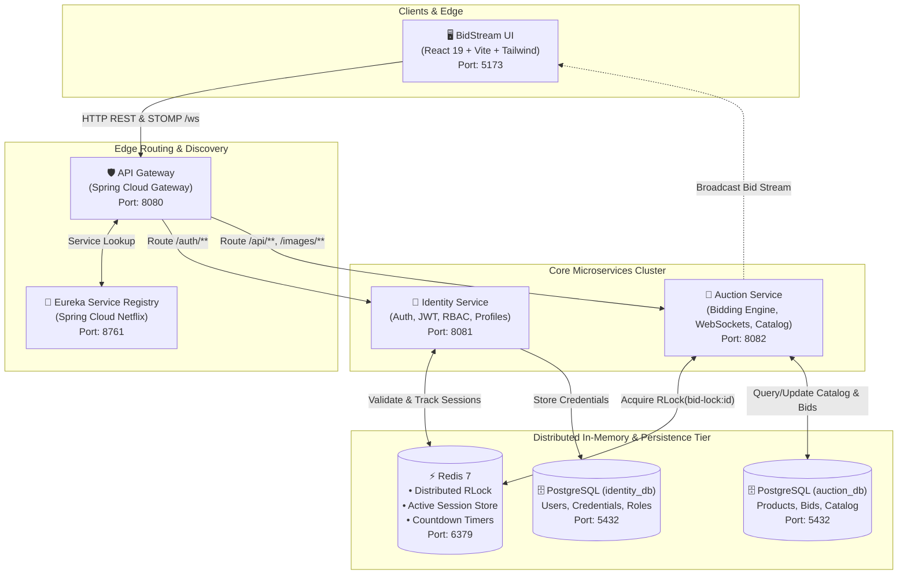

# ⚡ BidStream

<div align="center">

[](https://github.com/Palash606/BidStream/actions/workflows/ci.yml)
[](https://opensource.org/licenses/Apache-2.0)
[](CONTRIBUTING.md)
[](https://openjdk.org/projects/jdk/21/)
[](https://spring.io/projects/spring-boot)
[](https://redis.io/)
[](https://www.postgresql.org/)
[](https://react.dev/)

**A real-time, event-driven distributed auction platform handling 1,000+ concurrent bidders with sub-100ms latency.**

[Architecture](docs/ARCHITECTURE.md) •
[Quick Start](#-quick-start) •
[Services & Ports](#-services--ecosystem) •
[Contributing](CONTRIBUTING.md) •
[Security](SECURITY.md)

</div>

---

## 🌟 Overview

**BidStream** is a cloud-native, high-throughput distributed auction platform engineered for live, high-frequency bidding events (e.g., sports player auctions, rare collectibles, enterprise liquidation). 

Traditional auction systems break under load due to database connection exhaustion, latency spikes in WebSocket fan-out, and race conditions where multiple bidders attempt to claim the same price tick simultaneously. BidStream resolves these bottlenecks with:

- **Redisson Distributed Locks** on hot auction items (`RLock` with millisecond timeouts) to ensure serialized, atomic bid resolution without database table deadlocks.
- **Sub-100ms STOMP over WebSockets** broadcasting instant bid updates, countdown clocks, and outbid alerts to connected clients.
- **Polyglot Storage Architecture**: In-memory Redis for distributed locking, rate-limiting, and real-time session validation; relational PostgreSQL for ledger-grade financial and auction integrity.
- **Enterprise Security Rules**: Single active session enforcement per user in Redis, dynamic bidder/seller role switching, and strict automated anti-self-bidding rules.

---

## 🏛️ System Architecture



---

## 🚀 Quick Start

Get the entire 6-service ecosystem running locally in **3 simple steps**:

### Prerequisites
- **Java 21** (`java -version`)
- **Node.js 18+** & `npm`
- **Docker** and **Docker Compose**

### Step 1: Clone and Configure Environment
```bash
git clone https://github.com/Palash606/BidStream.git
cd BidStream

# Copy sample environment configuration
cp .env.example .env.local
```
*(Optionally adjust credentials or JWT secrets in `.env.local` if needed).*

### Step 2: Spin Up Infrastructure (PostgreSQL & Redis)
```bash
docker-compose up -d
```
This initializes PostgreSQL (with `identity_db` and `auction_db`) and Redis on default ports.

### Step 3: Launch All Services (One Command)
Run the automated boot orchestrator to compile and start Eureka, Identity Service, Auction Service, API Gateway, and the UI:

```bash
chmod +x full-clean-boot.sh
./full-clean-boot.sh
```

Once booted, open your browser and navigate to:
👉 **[http://localhost:5173](http://localhost:5173)**

---

## 📦 Services & Ecosystem

| Service | Port | Tech Stack | Responsibility |
| :--- | :--- | :--- | :--- |
| **BidStream UI** | `5173` | React 19, Vite, Tailwind CSS, Zustand | Interactive bidder arena, seller lot management, real-time STOMP client |
| **API Gateway** | `8080` | Spring Cloud Gateway, Reactive WebFlux | Single entry point, CORS deduplication, Eureka load-balancing, rate-limiting |
| **Eureka Server** | `8761` | Spring Cloud Netflix Eureka | Dynamic service registration, health heartbeats, microservice discovery |
| **Identity Service** | `8081` | Spring Boot 3, Spring Security, jjwt, PostgreSQL | User registration, dual-role switching, JWT issuance, single-session guard |
| **Auction Service** | `8082` | Spring Boot 3, WebSocket (STOMP), Redisson, Redis, JPA | Live auction lifecycle, atomic bidding with Redisson `RLock`, product catalog |
| **PostgreSQL** | `5432` | Postgres 15 | Persistent storage (`identity_db`, `auction_db`) |
| **Redis** | `6379` | Redis 7 Alpine | Distributed locks, session storage, IPL 3-hit countdown timers |

---

## 🔑 Key Engineering Highlights

### 1. Eliminating Race Conditions in High-Velocity Bidding
When hundreds of users submit bids simultaneously on the same item, traditional database row locking creates severe contention and thread starvation. BidStream uses **Redisson Distributed Locks**:
```java
RLock lock = redissonClient.getLock("bid-lock:" + productId);
if (lock.tryLock(5, 10, TimeUnit.SECONDS)) {
    try {
        // Atomic evaluation of minimum increment & winner assignment
    } finally {
        if (lock.isHeldByCurrentThread()) lock.unlock();
    }
}
```
Read the technical deep-dive in [docs/ARCHITECTURE.md](docs/ARCHITECTURE.md).

### 2. Single-Session Enforcement
To prevent credential sharing and conflicting multi-device operations (such as bidding against oneself from another window), BidStream invalidates old session tokens in Redis upon any new login.

### 3. Strict Anti-Self-Bidding Guard
Sellers cannot bid on their own auction lots. Both the frontend floor and backend API strictly validate `bidderId != sellerId`, rejecting attempts with `403 Forbidden`.

---

## 🛠️ Repository Layout

```text
BidStream/
├── .github/
│   ├── ISSUE_TEMPLATE/          # Structured Bug & Feature issue templates
│   ├── workflows/ci.yml         # Automated GitHub Actions CI pipeline
│   ├── copilot-instructions.md  # AI context & coding standards
│   └── PULL_REQUEST_TEMPLATE.md # PR verification checklist
├── .cursorrules                 # Cursor IDE / agent rules
├── api-gateway/                 # Spring Cloud API Gateway (Port 8080)
├── auction-service/             # Auction & Real-Time Bidding Service (Port 8082)
├── bidstream-ui/                # React 19 Frontend Web Application (Port 5173)
├── docs/
│   └── ARCHITECTURE.md          # Architectural deep-dive & sequence flows
├── eureka-server/               # Service Discovery Registry (Port 8761)
├── identity-service/            # Auth & User Management Service (Port 8081)
├── init-sql/                    # Database initialization scripts
├── docker-compose.yml           # Local Postgres & Redis container orchestration
├── full-clean-boot.sh           # Clean boot script for all microservices
├── CONTRIBUTING.md              # Contributor guide & standards
├── CODE_OF_CONDUCT.md           # Contributor Covenant v2.1
├── SECURITY.md                  # Security guidelines & vulnerability reporting
└── LICENSE                      # Apache 2.0 License
```

---

## 🤝 Contributing

We welcome contributions from developers, testers, and AI-assisted workflows! Whether it's adding a new feature, fixing a bug, or improving documentation:

1. Read our [CONTRIBUTING.md](CONTRIBUTING.md) guide.
2. Adhere to our [Code of Conduct](CODE_OF_CONDUCT.md).
3. Follow the branch naming (`feature/`, `fix/`) and commit conventions.
4. Open a Pull Request using our [PR Template](.github/PULL_REQUEST_TEMPLATE.md).

---

## 🔒 Security

Security is critical to distributed financial and auction platforms. Please review our [SECURITY.md](SECURITY.md) for details on our responsible disclosure process, supported versions, and private vulnerability reporting channels.

---

## 📄 License

BidStream is open-source software licensed under the **[Apache License 2.0](LICENSE)**.
