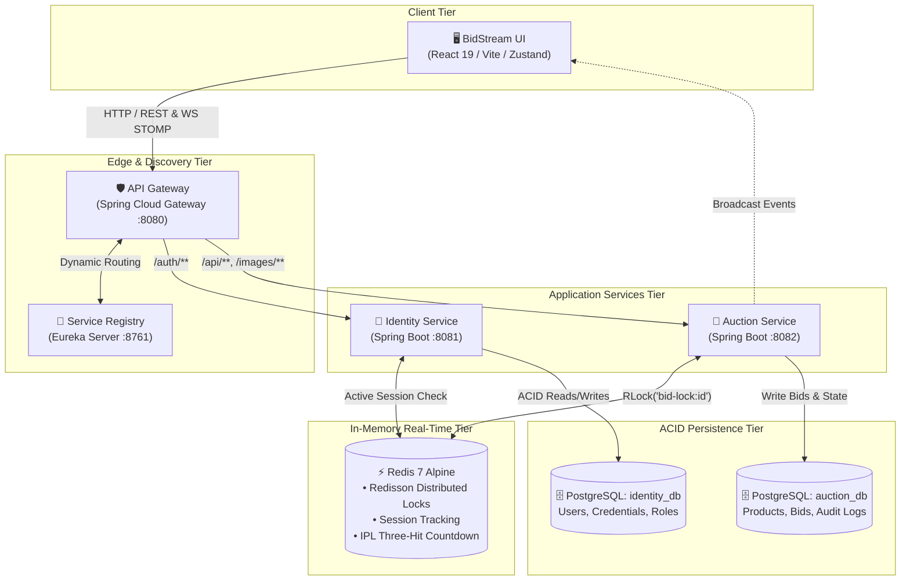
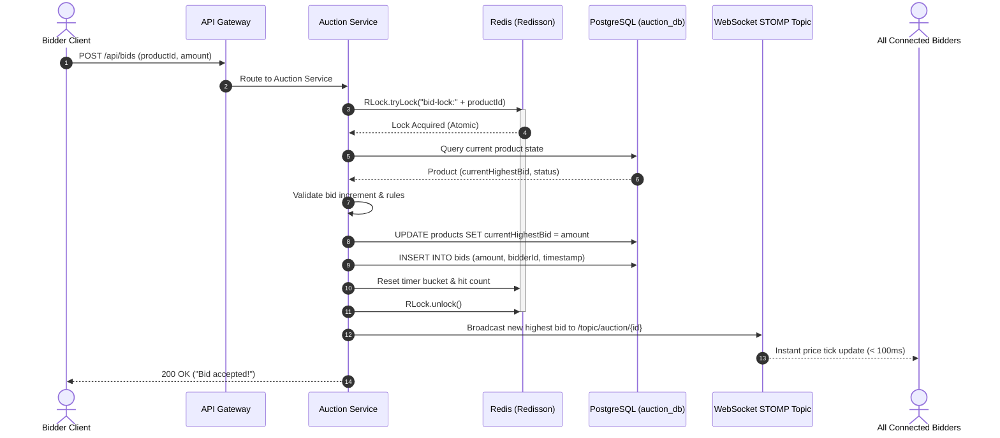
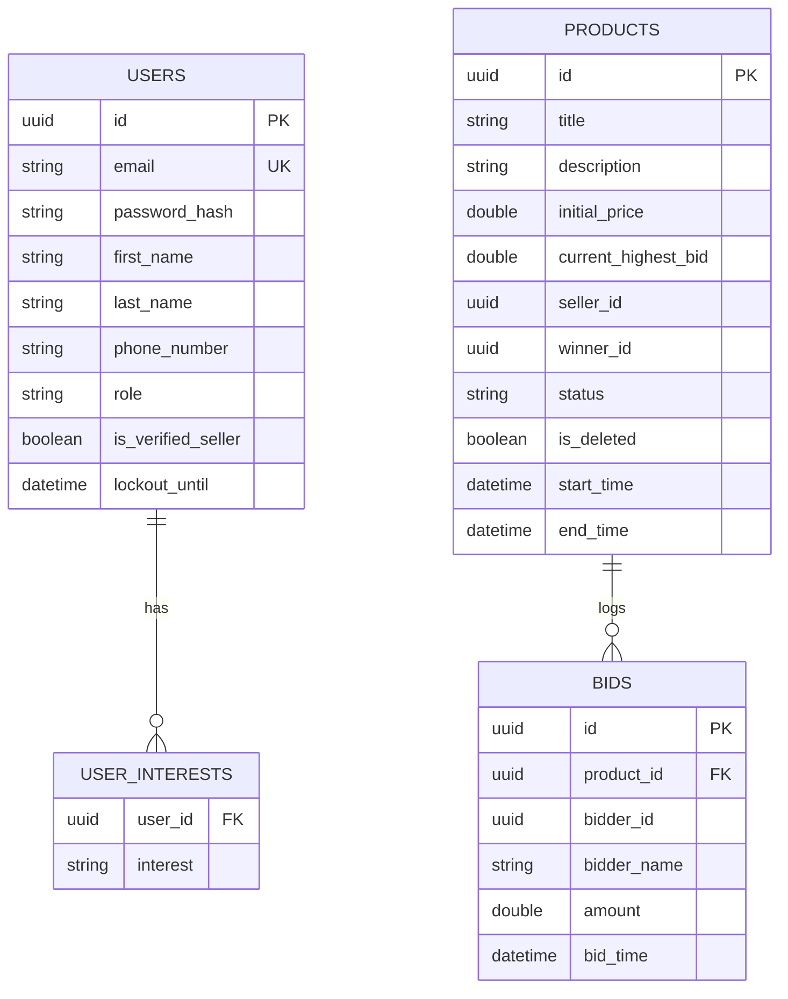

# 🏛️ BidStream System Architecture & Technical Deep Dive

This document provides a comprehensive technical overview of **BidStream**, an event-driven, distributed real-time auction platform designed to handle **1,000+ concurrent bidders** with **sub-100ms latency**.

---

## 1. System Philosophy & Objectives

Live auction platforms represent one of the most demanding challenges in distributed systems engineering. Unlike typical e-commerce platforms where eventual consistency is acceptable in product browsing, an auction requires:
1. **Strict Linearizability**: Every bid on a lot must be strictly ordered. No two bidders may claim the same price tick.
2. **Sub-100ms Latency**: Auction participants must see competitive bids immediately to react before the countdown hammer strikes.
3. **Resilience under Hotspots**: Popular auction lots concentrate thousands of simultaneous write requests onto a single entity key.
4. **Zero Financial Drift**: In-memory speeds must never sacrifice persistent auditability and transactional integrity.

To solve this, BidStream decouples write synchronization (managed via in-memory distributed locks in Redis) from read distribution (fanned out via STOMP WebSockets), backed by relational persistence for final state settlement.

---

## 2. Six-Service Ecosystem Overview



### Microservice Responsibilities

| Service | Port | Primary Responsibilities |
| :--- | :--- | :--- |
| **BidStream UI** | `5173` | Interactive bidder arena, real-time price tick visualization, seller product onboarding, dual-role dashboard switching. |
| **API Gateway** | `8080` | Edge routing, dynamic Eureka service discovery load balancing, global CORS management, and request rate-limiting. |
| **Eureka Server** | `8761` | Dynamic service registration, heartbeat failure detection, and service registry discovery. |
| **Identity Service** | `8081` | User registration, authentication, JWT token lifecycle (access + refresh), dynamic role assignment, single-session Redis tracking. |
| **Auction Service** | `8082` | Product catalog, soft-delete management, Redisson distributed lock synchronization, live bid validation, WebSocket STOMP broadcasting. |
| **PostgreSQL** | `5432` | Dual-database persistence (`identity_db` and `auction_db`) for immutable historical records and account security. |
| **Redis** | `6379` | Sub-millisecond distributed lock coordinator (`RLock`), active session registry, and auction timer state buckets. |

---

## 3. Concurrency & Race Condition Resolution

### The Problem: Database Contention
When hundreds of bidders click "Bid" at the exact same millisecond:
- Traditional **Database Row Locking** (`SELECT FOR UPDATE`) causes database thread starvation, HikariCP pool exhaustion, and cascading timeouts.
- **Optimistic Locking** (`@Version`) results in high abort rates: 99% of bidders receive generic retry/conflict errors, causing frustrating UX.

### The Solution: Redisson Distributed Locks
BidStream utilizes **Redisson distributed locks** (`RLock`) managed in Redis. Locks are scoped per auction product:
`bid-lock:{productId}`

```java
@Transactional
public String placeBid(UUID productId, UUID bidderId, String bidderName, Double amount) {
    RLock lock = redissonClient.getLock("bid-lock:" + productId);
    try {
        // Wait up to 5s to acquire lock, automatically release after 10s lease
        if (lock.tryLock(5, 10, TimeUnit.SECONDS)) {
            Product product = productRepository.findById(productId).orElseThrow();
            
            // 1. Validate status
            if (product.getStatus() != ProductStatus.ACTIVE) return "Auction not active.";
            
            // 2. Anti-Self-Bidding rule
            if (product.getSellerId().equals(bidderId)) return "Sellers cannot bid on their own items.";
            
            // 3. Minimum increment validation
            double currentPrice = product.getCurrentHighestBid() == null ? product.getInitialPrice() : product.getCurrentHighestBid();
            double minIncrement = calculateMinIncrement(currentPrice);
            if (amount < (currentPrice + minIncrement)) {
                return "Minimum next bid must be ₹" + (currentPrice + minIncrement);
            }

            // 4. Update highest bid and winner
            product.setCurrentHighestBid(amount);
            product.setWinnerId(bidderId);
            productRepository.save(product);

            // 5. Append immutable bid history record
            bidRepository.save(Bid.builder()
                    .productId(productId)
                    .bidderId(bidderId)
                    .bidderName(bidderName)
                    .amount(amount)
                    .build());

            // 6. Reset the "Three-Hit" timer (IPL auction logic)
            redissonClient.getBucket("auction-timer:" + productId).set(System.currentTimeMillis());
            redissonClient.getBucket("auction-hit-count:" + productId).set(0);

            return "Bid accepted!";
        }
    } catch (InterruptedException e) {
        Thread.currentThread().interrupt();
        throw new RuntimeException("Bid interrupted", e);
    } finally {
        if (lock.isHeldByCurrentThread()) lock.unlock();
    }
    return "Could not acquire bid lock. Please try again.";
}
```

### Live Bidding Sequence Flow



---

## 4. Auction Lifecycle & The "Three-Hit" Timer Logic

To recreate the excitement of a live auction gavel (e.g., *"Going once... Going twice... Sold!"*):
1. Each lot has an active countdown timer stored in Redis: `auction-timer:{productId}`.
2. Whenever a legitimate higher bid is placed, the timer resets, and the hit counter `auction-hit-count:{productId}` is reset to `0`.
3. An automated background scheduler checks active auctions:
   - **Warning 1**: If no bid for $T$ seconds $\rightarrow$ broadcast *"Going once!"* (Hit count: 1)
   - **Warning 2**: If no bid for $2T$ seconds $\rightarrow$ broadcast *"Going twice!"* (Hit count: 2)
   - **Hammer Strike**: If no bid for $3T$ seconds $\rightarrow$ mark lot `COMPLETED`, assign winner, and trigger settlement notification.

---

## 5. Polyglot Persistence & Data Models

### Database Isolation (Microservices Pattern)
To maintain true service autonomy:
- `identity-service` connects exclusively to `identity_db`.
- `auction-service` connects exclusively to `auction_db`.



### Redis Key Namespaces

| Key Pattern | Type | TTL | Purpose |
| :--- | :--- | :--- | :--- |
| `bid-lock:{productId}` | Distributed Lock | 10 seconds | Redisson mutex serializing write bids on product. |
| `auction-timer:{productId}` | Value (Timestamp) | Auto-expiring | Stores epoch millis of the last accepted bid. |
| `auction-hit-count:{productId}` | Integer (0-3) | Auto-expiring | Tracks current warning state (Going once, twice, sold). |
| `session:{userId}` | String (Token) | 15 minutes | Enforces single active session per user across devices. |

---

## 6. Real-Time WebSocket Architecture

BidStream leverages **STOMP (Simple Text Oriented Messaging Protocol)** over **SockJS**:
- **Connection Endpoint**: `/ws-auction`
- **Topic Channels**:
  - `/topic/auction/{productId}`: Real-time bid events, current price ticks, and masked winner badges.
  - `/topic/timer/{productId}`: Live synchronization of remaining seconds and gavel warnings.

### Anonymity & Masking
To preserve bidder privacy while assuring the audience of competitive integrity:
- Bidder names are dynamically masked (e.g., `Palash Shah` $\rightarrow$ `P***h S.`) before being broadcast to the public STOMP topic.
- Dedicated user color hashes are calculated deterministically to give each bidder a distinctive visual avatar across bids without leaking identity.

---

## 7. Scalability & Future Roadmap

1. **Apache Kafka Integration**: Transition internal asynchronous audit logging and payment settlement triggers to high-throughput Kafka topics.
2. **WebSocket Cluster Fan-Out**: Scale the Auction Service horizontally behind Redis Pub/Sub so that WebSocket clients connected to separate server nodes receive unified broadcasts.
3. **Automated AI Appraiser**: Integrate Spring AI models to analyze product descriptions and seller photos, suggesting optimal reserve prices and fraud flags.
